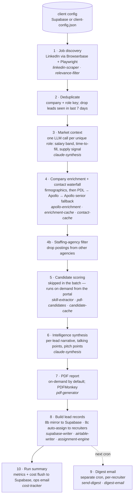

# Kurrent engine

Kurrent is a recruitment-intelligence pipeline for staffing agencies. Each morning it scrapes LinkedIn for the roles and cities an agency places in, collapses duplicate postings, enriches each hiring company, finds a hiring contact it can actually verify, has an LLM write a short market take per lead, and writes the ranked leads to the agency's portal database and a digest email. Candidate search and scoring runs on demand from the portal rather than in the nightly batch. This repository is the engine: the ten-stage pipeline, its supporting modules, the unit tests and the BDD specs. The portal (a Next.js dashboard) lives in a separate repository.

Node.js, CommonJS, no framework. External services: Browserbase + Playwright for scraping, Apollo and People Data Labs for enrichment and candidates, the Anthropic API for synthesis, PDFMonkey for reports, Resend for email, Supabase (Postgres) as the system of record, Airtable as an optional legacy sink.

## The ten stages



Each stage is a function over a shared run context (`createRunContext` builds it: tier, today's roles and locations, metrics, cost tracker). `runPipeline` just walks the `STAGES` array. Stages hand results to each other through `metrics.steps.<stage>`, record their own duration and errors, and a stage failing logs and continues rather than aborting the run (see `bdd/features/10-error-resilience.feature`). Tier config (`starter` / `growth` / `scale` / `founding_partner`) caps roles, locations and results per role.

Two stages are deliberately dormant in this version and left in place: Indeed scraping (`indeed-scraper.js`) is unplugged because Indeed's bot detection blocks it, and bulk candidate scoring (stage 5) moved to an on-demand action in the portal to stop spending PDL credits on roles nobody opens. The modules still ship and are tested.

## The contact waterfall

Stage 4 is where the main design decision lives. A lead without a reachable human is a posting, not a lead — so the engine spends enrichment credits in a fixed order and **rejects anything it can't verify** rather than filling the field with a guess.

1. **PDL person search** at the company domain. If enrichment returned no domain, try PDL domain resolution first. PDL returns a real name and usually a work email, and never redacts.
2. **Apollo, headcount-aware.** Small companies: owner / partner / principal titles. Mid and large: HR and talent-acquisition titles. Apollo's basic tier redacts names on a large share of matches; a redacted match (title but no name) is **rejected outright**, not stored as a partial.
3. **Apollo senior fallback.** CEO, President, Director, VP, Managing Director, General Manager — a last resort, tried only if 1 and 2 found nothing.

Each contact carries a `contactQuality` of `verified` (name plus email or LinkedIn URL), `partial` (name only) or `none`. The portal and digest rank verified contacts first. The trade-off is deliberate: fewer leads carry a contact, but the ones that do are deliverable, and the agency isn't paying Apollo credits for rows it can't act on. Contacts are cached by domain for 30 days (`contact-cache`), companies for 90 (`enrichment-cache`), so recurring posters don't get re-bought every morning.

## Layout

```
kurrent-pipeline.js      createRunContext + one function per stage + STAGES + runPipeline
kurrent-pipeline.test.js end-to-end: all stages with every external module stubbed
run-now.js               entry point: loads every client config, runs the pipeline for each
ops-alerts.js            the three ops emails run-now.js can send (failure / zero leads, timeout, LinkedIn re-auth)
send-digest.js           separate entry point for the morning digest (own cron)

linkedin-scraper.js      stage 1
indeed-scraper.js        stage 1 (currently unplugged — see above)
relevance-filter.js      stage 1 — title allow/block lists in relevance-config.json
claude-synthesis.js      stages 3 and 6
apollo-enrichment.js     stage 4 — enrichment and the contact waterfall
enrichment-cache.js      stage 4 — Supabase-backed company/contact cache
contact-cache.js         stage 4 — Supabase-backed contact cache by domain
skill-extractor.js       stage 5 / on-demand — LLM pulls searchable skills from a job description
pdl-candidates.js        stage 5 / on-demand — candidate search and scoring (WARM / POSSIBLE / STRETCH)
candidate-cache.js       stage 5 / on-demand — Supabase-backed cache by role/location/seniority
pdf-generator.js         stage 7
supabase-writer.js       stage 8b
airtable-writer.js       stage 8 (optional)
assignment-engine.js     stage 8c — pure, weighted recruiter assignment; role match is a hard gate
digest-email.js          stage 9 — HTML digest
cost-tracker.js          stage 10 — per-call cost log with monthly budget alerts
supabase-config-loader.js  client configs from Supabase, falling back to client-config.json
security/config-loader.js  env validation and log masking

bdd/features/*.feature   11 Gherkin specs, 95 scenarios, one per stage plus tiers and resilience
bdd/agents/qa-runner.js  executes the scenarios against the real modules with mocked APIs
bdd/bdd-runner.js        validates the specs and versions them (bdd-version.json)
bdd/support/mock-apis.js canned Apollo / PDL / Claude responses

samples/                 what the stages consume and produce, with invented companies and people
  jobs.sample.json         stage 1 output — raw postings before dedup
  lead.sample.json         stage 8 output — one lead record as written to the portal
  run-summary.sample.json  stage 10 output — run metrics
```

## Running it

```
npm install
cp .env.example .env               # fill in the keys you have
cp client-config.example.json client-config.json
node run-now.js                    # full run for every configured client
TEST_MODE=true node run-now.js    # one role, one location, one result — conserves credits
node send-digest.js                # morning digest
```

Without `SUPABASE_URL` the pipeline reads `client-config.json` and skips the Supabase writes; without `PDFMONKEY_API_KEY` stage 7 is skipped. Stage 1 needs Browserbase — there is no local-browser mode.

Tests run without any keys:

```
npm run lint          # node --check over every tracked .js file
npm test              # node:test — assignment engine, skill extractor, and the end-to-end pipeline run
npm run test:bdd      # QA runner: BDD scenarios against the real modules with mocked APIs
npm run bdd:validate  # checks every feature file parses and matches the version manifest
```

`kurrent-pipeline.test.js` installs stubs for every external module into `require.cache`, runs `runPipeline` end to end on `samples/jobs.sample.json`, and asserts what each stage handed to the next — dedup count, one market-context call per role, one enrichment and one contact lookup per company, the written lead records, deferred digest, cost flush. It also checks tier caps, test mode, and that a failing stage doesn't stop the run. The candidate-cache BDD scenarios are skipped unless `SUPABASE_URL` and `SUPABASE_SERVICE_ROLE_KEY` are set, because the cache is Supabase-backed. `.github/workflows/test.yml` runs all four on push.

## Environment variables

| Variable | Used by | Required |
|---|---|---|
| `CLAUDE_API_KEY` | stages 3, 5, 6 | yes |
| `BROWSERBASE_API_KEY`, `BROWSERBASE_PROJECT_ID` | stage 1 | yes |
| `LINKEDIN_EMAIL`, `LINKEDIN_PASSWORD` | stage 1 (LinkedIn session) | for LinkedIn |
| `APOLLO_API_KEY` | stage 4 | yes |
| `PDL_API_KEY` | stage 4 contact waterfall; on-demand candidate search | for contacts via PDL |
| `PDFMONKEY_API_KEY` | stage 7 | for PDFs |
| `RESEND_API_KEY` | stages 9, 10 | yes |
| `AIRTABLE_API_KEY`, `AIRTABLE_BASE_ID` | stage 8 | only if writing to Airtable |
| `SUPABASE_URL`, `SUPABASE_ANON_KEY` | config loader | for multi-client |
| `SUPABASE_SERVICE_ROLE_KEY` | stages 4, 5, 8b, 10 and config | for Supabase writes |
| `SENTRY_DSN_PIPELINE` | error tracking | no |
| `OPS_EMAIL` | failure and summary alerts | no |
| `STRIPE_SECRET_KEY`, `STRIPE_PUBLISHABLE_KEY` | reserved | no |

Keys are read from `process.env` only. `security/config-loader.js` checks the required set before a run starts and masks values in logs.

## Not included

The portal (Next.js dashboard), the database migrations, the HTML report templates, and the operational tooling around a live deployment are in the private repository. All names, companies, emails and figures in `samples/` and `bdd/support/mock-apis.js` are invented.
